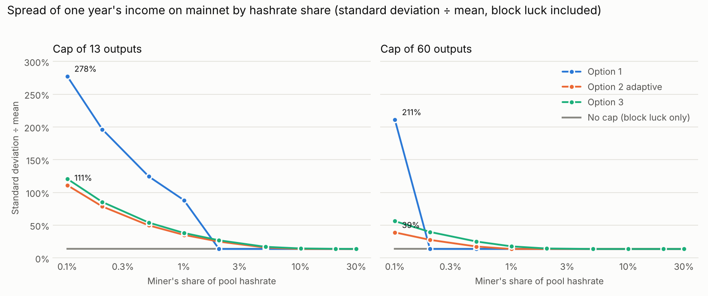
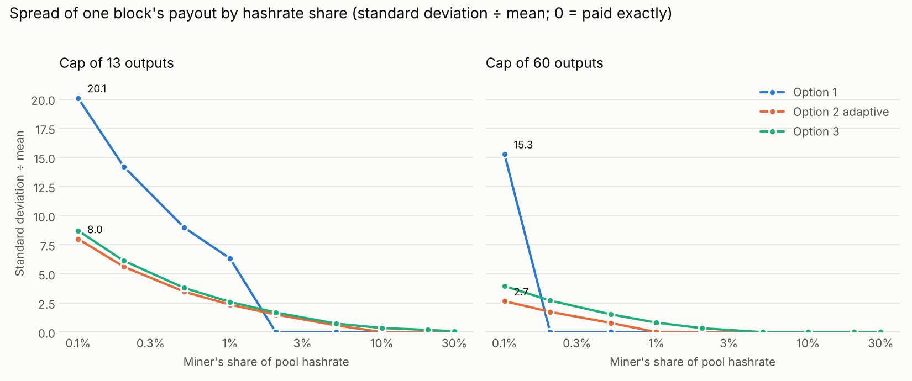

# Paying the long tail under a coinbase output cap

**p2poolv2 payout analysis · 17 November 2026 · revised for current network hashrate, with no miner smaller than an S19**

Options considered, simulation results, expected earnings against today's pools, and a recommendation. Each claim links to the README of the simulation behind it; the code and its output sit in the same folder.

**Reading the percentages.** Every hashrate percentage in this report is a share of the **pool**, not of the Bitcoin network, unless it says "of the network". The pool is 1 EH/s, which is 0.1% of the network.

| Miner | Hashrate | Share of pool | Share of network |
|---|---|---|---|
| One Antminer S19 (the smallest miner) | 95 TH/s | 0.0095% | 0.0000095% |
| One Antminer S21 | 200 TH/s | 0.02% | 0.00002% |
| "0.1% of the pool" | 1 PH/s | 0.1% | 0.0001% |
| "1% of the pool" | 10 PH/s | 1% | 0.001% |
| "10% of the pool" | 100 PH/s | 10% | 0.01% |
| The whole pool | 1 EH/s | 100% | 0.1% |

## 1. Summary

ASIC firmware limits how large a coinbase a miner can hash, so a p2poolv2 block cannot carry one output for every miner in the PPLNS window. Four ways of deciding who is paid in a given block were compared.

**Recommendation: option 2 (N top + M random), with N and M set per block by a threshold rule instead of being fixed.** It is unbiased, has the lowest variance any unbiased rule can have for a given cap, gains nothing for sock puppets, and gives a single-address miner nothing to grind.

**Earnings against today's pools** ([14][14]):

- **Expected earnings are the same for every miner and every scheme.** With no pool fee assumed, p2poolv2 pays full hashprice: 4,304 sats a day for one S19 and 9,060 for one S21. An FPPS pool with a 2% fee pays 4,218 and 8,879; with a 4% fee, 4,132 and 8,698.
- **Large miners keep that 2% to 4% with only pool luck added.** A miner paid in every block sees a year's income between 78% and 124% of expected. At a cap of 60 that is every miner from about 0.8% of the pool (8 PH/s) up; at a cap of 13, from about 6.7% (67 PH/s) up.
- **For a single machine a small cap turns the pool into a lottery.** At a cap of 13 one S19 has a 92.6% chance of no payout in a year; when it wins it receives 20.4 million sats, thirteen years of earnings. At a cap of 60 the chance of no payout in a year is 54% for an S19 and 27% for an S21. An FPPS pool pays the same S19 about every 24 days.
- **How large a cap single machines need.** With 1,000 miners, one S19 is paid about once a year at a cap of 85 and about monthly at a cap near 500.

The cap matters more than the option, and the option matters most for the smallest miners. Under option 1 one S19 has a 98% to 99% chance of no payout in a year at either cap, because the single prize is 23% to 40% of the block.

## 2. Network and pool assumptions

All mainnet figures are rooted in the network as of November 2026 ([14][14] lists the sources).

| Input | Value | Source |
|---|---|---|
| Network hashrate | 1,000 EH/s | recent 7-day averages of 958 to 1,069 EH/s |
| Block reward | 3.125 BTC + 0.021 BTC fees | fees were 0.66% of block rewards in October 2026 |
| BTC price | $75,000 | for USD conversions only |
| Mainnet pool | 1 EH/s, 0.1% of the network | project target |
| Pool block rate | 1.0 a week, 52.6 a year on mainnet; 50 a day on testnet5 | follows from the hashrate |
| Smallest miner | one S19, 95 TH/s | project requirement |
| Miner limit | 1,000 miners | p2p network scale limit |
| Share chain | 10-second shares; a late share earns 90% as an uncle | project design |
| Raffle seed | hash of the parent share | project proposal |
| p2poolv2 pool fee | none | **assumed** |

The firmware report in [simulation 09][09] measures a job-message limit of 3,072 bytes on one 2021 S19j Pro build and 5,120 bytes on two newer builds. With mixed address types and a count-based rule every output has to be assumed taproot-sized, which gives two caps used throughout:

- **13 outputs**: fits any block on the 3,072-byte build.
- **60 outputs**: fits any block on the 5,120-byte builds.

Miner populations, all **assumed**:

| Population | Composition | Share of pool hashrate |
|---|---|---|
| Mainnet, 1,000 miners | 4 farms (6.6% to 11.9% each) | 41.5% |
| | 25 small farms of 3 to 30 PH/s | 30.2% |
| | 250 miners with 2 to 20 machines | 18.4% |
| | 721 miners with one machine (60% an S19, 40% an S21) | 9.8% |
| Mainnet, 500 miners | same small farms and multi-machine miners, 221 single machines (3.1%), larger farms (48.3%) | |
| Testnet5 | 124 miners: 4 rigs, 20 single ASICs, 100 small devices | |

Two modelling choices follow from the miner limit, both tested in [simulation 13][13]: a smaller pool has fewer single-machine miners, and a sock-puppet miner's addresses count toward the 1,000 places. The robustness check in [simulation 02][02] repeats the main comparison on 600 random populations of up to 1,000 miners with none below one S19.

## 3. Terms

- **Cap (K)**: the largest number of miner outputs a coinbase may carry.
- **Paid exactly**: the miner receives its PPLNS share in the block, with no randomness.
- **Raffle slot, prize**: an output assigned at random among the miners not paid exactly; the prize is what that output pays.
- **Tail**: the miners not paid exactly in a given block.
- **Sock puppets**: one miner splitting its hashrate across many addresses.
- **Spread**: standard deviation ÷ mean.
- **Variance vs no cap**: how much more variable a miner's income is than it would be with one output per miner. A value of 65 means income behaves as if the pool found 65 times fewer blocks.

## 4. Options considered

Figures in this section are for the 1,000-miner mainnet pool unless a column says otherwise.

### Option 1: N top + 1 random

The K − 1 largest miners are paid exactly. One slot pays the combined share of everyone else to a single tail miner, chosen with probability proportional to its shares.

**Pros**

- Unbiased ([01][01]).
- Pays the most miners exactly: 12 at a cap of 13, 59 at a cap of 60 ([02][02]).
- Best outcome for mid-sized miners just inside the top set. A miner with 2% of the pool at cap 13 is paid exactly, where option 2 would raffle it ([03][03]).
- Splitting hashrate does not change the expected payout ([04][04]).
- Simplest to implement: one weighted draw.

**Cons**

- The single prize is the whole tail: 40.5% of the block at cap 13 and 23.4% at cap 60 ([02][02]).
- Longest waits for small miners. A miner with 0.1% of the pool is paid every 2,813 days at cap 13, against 451 under the recommended rule; one S19 at cap 60 waits 17,116 days against 588 ([02][02]).
- Highest variance for small miners: the yearly income of a miner with 0.1% of the pool has a spread of 278% at cap 13, against 111% ([03][03]).
- Across 300 random populations its raffle variance is 4.35 times that of the recommended rule at cap 13 and 16 times at cap 60, at the median ([02][02]).
- Most exposed to seed grinding. The prize exceeds the 10% uncle penalty in 89% of random populations at cap 13 ([02][02]). A miner with 20% of the pool in 400 addresses gains 19.1% from tip choice plus 11.0% from withholding at cap 13, and still 10.75% plus 7.2% at cap 60. Single-address miners gain too: 1.4% with 0.5% of the pool and 4.3% with 1.5% ([05][05]).
- Most exposed to crowd-out. A miner with 30% of the pool that splits pushes the prize from 29.6% to as much as 56.0% of the block and multiplies honest miners' raffle variance by up to 2.4 at cap 13 ([04][04]).

### Option 2: N top + M random

The N largest miners are paid exactly and M = K − N slots are raffled among the rest. Two details decide whether this works.

**How the winners are drawn.** Each slot must be a weighted draw that does not exclude earlier winners, or all slots must come from one evenly spaced weighted draw. Forcing the winners to be distinct addresses breaks fairness.

**How N and M are set.** They can be constants, or set per block by a threshold rule: pay a miner exactly while its share is larger than an even split of what remains among the remaining slots. This report calls the second form the **adaptive split**, and it is the recommended one.

**Pros (adaptive split, evenly spaced draw)**

- Unbiased ([01][01]).
- Lowest raffle variance of any unbiased rule with the same cap. It matches a numerical lower bound to within the optimiser's tolerance ([07][07]) and was never beaten in 600 random populations ([02][02]).
- Smallest prize: 6.5% of the block at cap 13 and 0.80% at cap 60, and never more than 1/K ([02][02]).
- Shortest waits: a miner with 0.1% of the pool is paid every 451 days at cap 13 and every 56 days at cap 60; one S19 every 4,749 and 588 days ([02][02]).
- Every miner above the threshold is paid exactly and has no added variance. That is everyone above about 6.7% of the pool at cap 13 and above about 0.8% at cap 60 ([03][03]).
- Splitting gains nothing and makes payouts less regular. A miner with 3% of the pool is paid in 58% of blocks as one address and in 46% as 30 addresses ([04][04]).
- Least exposed to grinding. A miner on a single address gains nothing at any cap above 10. A miner with 20% of the pool in 400 addresses gains 4.3% plus 2.2% at cap 13 and 0.07% plus 0.03% at cap 60 ([05][05]).
- Crowd-out is bounded. With a miner holding 30% of the pool splitting against them, honest miners still have less raffle variance than under option 1 or option 3 with no attack ([04][04]).
- When the window holds no more miners than the cap, everyone is paid exactly and there is no raffle ([02][02]).

**Cons**

- Fewer miners are paid in every block than under option 1: 4 against 12 at cap 13, and 19 against 59 at cap 60. Miners holding about 1.8% to 6.7% of the pool are raffled here and paid exactly there at cap 13. For a miner with 2% of the pool the yearly income spread is 25.0% instead of 13.8% ([03][03]).
- It is easy to implement wrongly. With distinct winners and equal prizes the smallest miners are overpaid by 13%, and a miner with 3% of the pool collects 0.89 of its share as one address and 1.10 as 30. With distinct winners and a pro-rata split the smallest miners get under 5% of their share. With excluded weight redistributed, the four largest miners take 35% extra ([01][01], [04][04]).
- A fixed split depends on the population. With half the slots raffled it is within about 12% of the adaptive split at the median but up to 2.3 times worse. With a fifth raffled it has 2.35 times the variance at cap 13, and its prize exceeds 10% of the block in 74% of populations ([02][02]).
- More consensus code than option 1: a threshold loop and an evenly spaced draw. An integer-only reference implementation is tested in [07][07].
- At small caps a large sock-puppet miner can still grind (about 6.5% at cap 13) and can raise honest miners' raffle variance 1.6 times by splitting ([05][05], [04][04]).

### Option 3: all weighted random

All K slots are raffled among all miners in proportion to their shares. Nobody is paid exactly.

**Pros**

- Unbiased ([01][01]).
- The prize is always exactly 1/K of the block: 7.7% at cap 13, 1.7% at cap 60 ([02][02]).
- Completely immune to crowd-out. Honest miners' payouts barely depend on how anyone else splits ([04][04]).
- Splitting does not change the expected payout ([04][04]).
- Easy to state: there is no top set to compute.

**Cons**

- Every miner carries raffle variance, including the largest. For a miner with 10% of the pool the yearly income spread is 14.6% at cap 13 instead of 13.8%; with independent draws even a miner with 30% is at 15.0% ([03][03]).
- Small miners wait longer than under the recommended rule: 18% longer at cap 13 (534 days against 451 for a miner with 0.1% of the pool) and twice as long at cap 60 (116 days against 56) ([02][02]).
- Raffle variance is 1.6 times the recommended rule's at cap 13 and 2.4 times at cap 60 at the median, and hundreds of times higher in top-heavy populations ([02][02]).
- More exposed to grinding than the recommended rule: 4.8% plus 2.5% for a miner with 20% of the pool in 400 addresses at cap 13 ([05][05]).

### Option 4: coinbase size set by the finder's hardware

The finder uses the largest coinbase its hardware can hash: 13 outputs on old firmware, 60 on newer. Any of options 1 to 3 supplies the rule at each size; the figures below use option 2 with the adaptive split.

**Pros**

- Small miners are paid more often. If a fifth of blocks carry 60 outputs, one S19 is paid every 1,965 days instead of 4,749, and a miner with 0.1% of the pool every 187 days instead of 451 ([06][06]).
- Old hardware keeps working; no miner is cut off.
- Honest miners' expected payouts stay proportional at either size ([06][06]).
- Most of the benefit survives gaming, because a small miner usually prefers the large size anyway ([06][06]).

**Cons**

- Hardware cannot be verified, so a miner that can hash the large coinbase can choose the small one after seeing the seed. Under the recommended rule this is the only way an ordinary single-address miner gains by gaming: about 1.1% for a miner with 1.5% of the pool ([06][06]).
- Sock puppets gain more: 4.15% for a miner with 20% of the pool in 400 addresses from the size choice alone and 5.9% combined with tip choice; 2.4% for 5% of the pool in 50 addresses ([06][06]).
- The gain is paid by the other miners in the raffle on those blocks. Every coinbase still pays out exactly the reward ([06][06]).
- Income variance improves far less than payout frequency: 65 times no-cap variance falls only to 54 times for a miner with 0.1% of the pool ([06][06]).
- With option 1 as the base rule the size choice is worth 11.7% ([06][06]).
- Each tip has two valid coinbases and a miner's payout for a tip depends on who finds the block. *Not simulated; an implementation cost.*

### Side by side, 500 and 1,000 miners

Both pools are 1 EH/s. Waits are mean days between payouts.

| | Option 1: 500 miners | Option 1: 1,000 miners | Option 2 adaptive: 500 | Option 2 adaptive: 1,000 | Option 3: 500 | Option 3: 1,000 |
|---|---|---|---|---|---|---|
| Prize, share of block, cap 13 | 33.7% | 40.5% | 5.75% | 6.50% | 7.7% | 7.7% |
| Prize, share of block, cap 60 | 16.7% | 23.4% | 0.64% | 0.80% | 1.7% | 1.7% |
| Miners paid in every block, cap 13 | 12 | 12 | 4 | 4 | 4 | 3 |
| 0.1% of pool paid every, cap 13 | 2,345 days | 2,813 days | 400 days | 451 days | 534 days | 534 days |
| 0.1% of pool paid every, cap 60 | 1,163 days | 1,631 days | 44.5 days | 56 days | 116 days | 116 days |
| One S19 paid every, cap 13 | 24,640 days | 29,571 days | 4,202 days | 4,749 days | 5,623 days | 5,623 days |
| One S19 paid every, cap 60 | 12,185 days | 17,116 days | 467 days | 588 days | 1,218 days | 1,218 days |
| Yearly income spread, 0.1% of pool, cap 13 | 253% | 278% | 105% | 111% | 121% | 121% |
| Yearly income spread, one S19, cap 60 | 578% | 685% | 113% | 127% | 183% | 183% |
| Yearly income spread, 2% of pool, cap 13 | 13.8% | 13.8% | 23.6% | 25.0% | 27.1% | 27.1% |
| Grinding gain, 20% of pool in 400 addresses, cap 13 | 13.2% + 8.4% | 19.1% + 11.1% | 3.2% + 1.7% | 4.3% + 2.2% | 4.6% + 2.3% | 4.9% + 2.5% |

Remaining comparisons, 1,000 miners, cap 13:

| | Option 1 | Option 2 adaptive | Option 3 |
|---|---|---|---|
| Grinding gain, single-address miner | up to 4.3% | 0 | 0 |
| Honest raffle variance after a miner with 30% of the pool splits | × 2.4 | × 1.6 | unchanged |
| Expected-payout gain from splitting | 0 | 0 | 0 |

Sources: [02][02], [03][03], [04][04], [05][05], [13][13]. Option 3 is shown with the evenly spaced draw, its better form. Option 4 is a layer on top of one of these and is not a column.

## 5. The recommended rule

Option 2 with the adaptive split and one evenly spaced draw. For a block with reward R, cap K and seed s:

1. Sort the miners in the PPLNS window by weight, largest first.
2. Walk down the list. Pay a miner exactly while its weight × (slots remaining) exceeds the weight remaining. Call the number paid exactly N.
3. The other M = K − N slots each pay the same prize: the remaining weight ÷ M.
4. Order the remaining miners by hash(s ‖ address). Derive one offset from s and place M evenly spaced points along their cumulative weights. Each point pays the miner it lands on.
5. If the window holds K miners or fewer, everyone is paid exactly.

Three properties follow from the construction: a tail miner wins with probability equal to its weight ÷ the prize, so its expected payout is its weight; there are exactly M winners; and no prize exceeds R/K.

An integer-only reference implementation, `adaptive_payout()`, is in [lib/payout_model.py](lib/payout_model.py). Over 240,000 blocks on noisy share windows it always paid out exactly the reward in at most 13 outputs and stayed unbiased ([07][07]).

The seed stays as the hash of the parent share. It must be a value a miner cannot vary without redoing the proof of work.

## 6. Payout variance by hashrate share, one S19 to 30% of the pool

A miner of each size was put into the mainnet population, in place of its smallest member, and its payout distribution computed under each option, for a pool of 500 miners and one of 1,000 ([03][03], [13][13]). Shares are of the pool: 0.1% is 1 PH/s, 30% is 300 PH/s.

### Spread of one year's income (standard deviation ÷ mean)

Block luck alone gives 13.8% at 52.6 blocks a year.

Cap 13:

| Share of pool | Option 1: 500 miners | Option 1: 1,000 miners | Option 2 adaptive: 500 | Option 2 adaptive: 1,000 | Option 3: 500 | Option 3: 1,000 |
|---|---|---|---|---|---|---|
| One S19 (0.0095%) | 822% | 900% | 339% | 361% | 392% | 392% |
| One S21 (0.02%) | 566% | 620% | 234% | 249% | 270% | 270% |
| 0.1% | 253% | 278% | 105% | 111% | 121% | 121% |
| 0.2% | 179% | 196% | 74% | 79% | 85.5% | 85.5% |
| 0.5% | 114% | 124.5% | 47% | 50% | 54% | 54% |
| 1% | 81% | 88% | 33% | 35% | 38% | 38% |
| 2% | 13.8% | 13.8% | 23.6% | 25.0% | 27.1% | 27.1% |
| 5% | 13.8% | 13.8% | 15.1% | 15.9% | 17.1% | 17.1% |
| 10% | 13.8% | 13.8% | 13.8% | 13.8% | 14.6% | 14.6% |
| 20% | 13.8% | 13.8% | 13.8% | 13.8% | 14.0% | 14.0% |
| 30% | 13.8% | 13.8% | 13.8% | 13.8% | 13.8% | 13.8% |

Cap 60:

| Share of pool | Option 1: 500 miners | Option 1: 1,000 miners | Option 2 adaptive: 500 | Option 2 adaptive: 1,000 | Option 3: 500 | Option 3: 1,000 |
|---|---|---|---|---|---|---|
| One S19 (0.0095%) | 578% | 685% | 113% | 127% | 183% | 183% |
| One S21 (0.02%) | 398% | 472% | 78% | 87% | 126% | 126% |
| 0.1% | 178.5% | 211% | 35% | 39% | 56% | 56% |
| 0.2% | 13.8% | 13.8% | 24.7% | 27.7% | 39.8% | 39.8% |
| 0.5% | 13.8% | 13.8% | 15.7% | 17.6% | 25.2% | 25.2% |
| 1% | 13.8% | 13.8% | 13.8% | 13.8% | 17.8% | 17.8% |
| 2% | 13.8% | 13.8% | 13.8% | 13.8% | 14.5% | 14.5% |
| 5% to 30% | 13.8% | 13.8% | 13.8% | 13.8% | 13.8% | 13.8% |

The chart shows the 1,000-miner pool from 0.1% to 30% of the pool.

### Variance of income relative to an uncapped coinbase, 1,000 miners

1.0 means the cap adds nothing to ordinary block luck.

| Share of pool | Cap 13: option 1 | Cap 13: option 2 adaptive | Cap 13: option 3 | Cap 60: option 1 | Cap 60: option 2 adaptive | Cap 60: option 3 |
|---|---|---|---|---|---|---|
| One S19 (0.0095%) | 4,258 | 684 | 810 | 2,465 | 85 | 175 |
| One S21 (0.02%) | 2,023 | 325 | 385 | 1,171 | 40 | 83 |
| 0.1% | 405 | 65 | 77 | 235 | 8.1 | 16.7 |
| 0.2% | 203 | 32.5 | 38.5 | 1.0 | 4.0 | 8.3 |
| 0.5% | 81.5 | 13.0 | 15.4 | 1.0 | 1.6 | 3.3 |
| 1% | 41 | 6.5 | 7.7 | 1.0 | 1.0 | 1.7 |
| 2% | 1.0 | 3.3 | 3.8 | 1.0 | 1.0 | 1.1 |
| 5% | 1.0 | 1.3 | 1.5 | 1.0 | 1.0 | 1.0 |
| 10% | 1.0 | 1.0 | 1.1 | 1.0 | 1.0 | 1.0 |
| 20% | 1.0 | 1.0 | 1.0 | 1.0 | 1.0 | 1.0 |
| 30% | 1.0 | 1.0 | 1.0 | 1.0 | 1.0 | 1.0 |

### The recommended rule in detail

How paid, chance per block and payout are for 1,000 miners. Days are mean days between payouts.

| Share of pool | Cap 13: how paid | Chance per block | Payout when paid | Cap 13, days: 500 miners | Cap 13, days: 1,000 miners | Cap 60: how paid | Cap 60, days: 500 miners | Cap 60, days: 1,000 miners |
|---|---|---|---|---|---|---|---|---|
| One S19 (0.0095%) | raffle | 0.15% | 6.50% of block | 4,202 | 4,749 | raffle | 467 | 588 |
| One S21 (0.02%) | raffle | 0.3% | 6.50% | 1,996 | 2,256 | raffle | 222 | 279 |
| 0.1% | raffle | 1.5% | 6.50% | 400 | 451 | raffle | 44.5 | 56 |
| 0.2% | raffle | 3.1% | 6.51% | 200 | 226 | raffle | 22.3 | 28 |
| 0.5% | raffle | 7.7% | 6.52% | 80 | 91 | raffle | 9.0 | 11.3 |
| 1% | raffle | 15.3% | 6.54% | 40 | 45 | exactly | 6.9 | 6.9 |
| 2% | raffle | 30.4% | 6.58% | 20.3 | 22.8 | exactly | 6.9 | 6.9 |
| 5% | raffle | 74.8% | 6.68% | 8.4 | 9.3 | exactly | 6.9 | 6.9 |
| 10% | exactly | 100% | 10% | 6.9 | 6.9 | exactly | 6.9 | 6.9 |
| 20% | exactly | 100% | 20% | 6.9 | 6.9 | exactly | 6.9 | 6.9 |
| 30% | exactly | 100% | 30% | 6.9 | 6.9 | exactly | 6.9 | 6.9 |

### Reading the tables

- Under the recommended rule a miner above the threshold has no added variance at all. The threshold is about 6.7% of the pool (67 PH/s) at cap 13 and about 0.8% (8 PH/s) at cap 60.
- Below the threshold, added variance is the prize divided by the miner's share, so halving a miner's share doubles its variance. That is why single machines sit so high: one S19 has 684 times no-cap variance at cap 13 and 85 times at cap 60.
- Option 1 is better for one band, about 1.8% to 6.7% of the pool at cap 13, and much worse for everyone smaller.
- Option 3 adds variance at every size.
- More miners in the same pool means a heavier tail, so for miners in the raffle the 1,000-miner columns are 6% to 12% worse than the 500-miner ones under the recommended rule and up to 19% worse under option 1. Section 8 explains why.

### Share-finding luck for small miners

The tables above hold a miner's window weight equal to its hashrate share. [Simulation 12][12] adds the lumpiness of finding shares: with a 2-week window of 120,960 shares, one S19 holds 11.5 shares on average and its window is never empty. Share luck lifts its yearly spread from 14% to 16% with no cap, and leaves the capped results unchanged.

One share is worth 5,243 sats on mainnet under every scheme. With no cap it is paid 2,601 sats by each block found while it is in the window, and 86.7% of shares are paid at least once. Under the recommended rule a share ever pays in 0.026% of cases at cap 13 (20.4 million sats) and 0.21% at cap 60 (2.53 million sats).

## 7. Expected earnings: p2poolv2 against today's pools

[Simulation 14][14] turns the payout rules into earnings for five miners and compares them with the pools miners use now.

### What each miner earns before fees

| Miner | Sats a day | USD a day | Sats a year | USD a year | Share of one p2poolv2 block |
|---|---|---|---|---|---|
| One S19 (95 TH/s) | 4,304 | 3.23 | 1,570,861 | 1,178 | 29,887 sats |
| One S21 (200 TH/s) | 9,060 | 6.80 | 3,307,075 | 2,480 | 62,920 sats |
| 1 PH/s (0.1% of pool) | 45,302 | 33.98 | 16.5 million | 12,402 | 314,600 sats |
| 10 PH/s (1% of pool) | 453,024 | 339.77 | 165 million | 124,015 | 3.146 million sats |
| 100 PH/s (10% of pool) | 4,530,240 | 3,397.68 | 1,654 million | 1,240,153 | 31.46 million sats |

At these figures one S19 breaks even on power at $0.041 per kWh and one S21 at $0.081. Power costs the same in any pool, so it does not enter the comparison.

### Expected earnings by pool, sats a day

| Pool | Fee | One S19 | One S21 | 1 PH/s | 10 PH/s | 100 PH/s |
|---|---|---|---|---|---|---|
| FPPS pool | 2% | 4,218 | 8,879 | 44,396 | 443,964 | 4,439,635 |
| FPPS pool | 4% | 4,132 | 8,698 | 43,490 | 434,903 | 4,349,030 |
| OCEAN (TIDES) | 2% | 4,218 | 8,879 | 44,396 | 443,964 | 4,439,635 |
| Solo via CKPool | 2% | 4,218 | 8,879 | 44,396 | 443,964 | 4,439,635 |
| p2poolv2, any option, any cap | none assumed | 4,304 | 9,060 | 45,302 | 453,024 | 4,530,240 |

Published FPPS fees range from 0% to 4% and large miners negotiate their own; the table in [14][14] lists them by pool. Every unbiased payout scheme pays the same on average, so on p2poolv2 the cap and the option do not change these figures. They change how the money arrives.

### How the money arrives: one year, 1,000 miners

Small miners. Each cell gives payouts a year / chance of no payout in the year / sats per payout.

| Scheme | One S19 | One S21 | 1 PH/s (0.1% of pool) |
|---|---|---|---|
| p2poolv2, no cap | 52.6 / 0% / 29,887 | 52.6 / 0% / 62,920 | 52.6 / 0% / 314,600 |
| p2poolv2, option 1, cap 13 | 0.01 / 98.8% / 127 million | 0.03 / 97.4% / 127 million | 0.13 / 87.8% / 127 million |
| p2poolv2, option 3, cap 13 | 0.06 / 93.7% / 24.2 million | 0.14 / 87.2% / 24.2 million | 0.68 / 50.5% / 24.2 million |
| p2poolv2, option 2 adaptive, cap 13 | 0.08 / 92.6% / 20.4 million | 0.16 / 85.1% / 20.4 million | 0.81 / 44.6% / 20.5 million |
| p2poolv2, option 1, cap 60 | 0.02 / 97.9% / 73.7 million | 0.04 / 95.6% / 73.7 million | 0.22 / 79.9% / 73.9 million |
| p2poolv2, option 3, cap 60 | 0.30 / 74.1% / 5.24 million | 0.63 / 53.2% / 5.24 million | 3.15 / 4.3% / 5.24 million |
| p2poolv2, option 2 adaptive, cap 60 | 0.62 / 53.7% / 2.53 million | 1.31 / 27.0% / 2.53 million | 6.5 / 0.1% / 2.53 million |
| FPPS pool, 2% fee | 15.4 / 0% / 100,000 | 32.4 / 0% / 100,000 | 162 / 0% / 100,000 |
| OCEAN, 2% fee, on-chain | 1.5 / 0% / 1.05 million | 3.1 / 0% / 1.05 million | 15.5 / 0% / 1.05 million |
| Solo, 2% fee | 0.005 / 99.5% / 308 million | 0.0105 / 99.0% / 308 million | 0.053 / 94.9% / 308 million |

FPPS and OCEAN payout counts are set by their minimum payout (100,000 sats is typical for FPPS pools; about 0.01 BTC on-chain for OCEAN, 1.05 million sats in the model); several pools pay smaller amounts over Lightning.

One S19 under the recommended rule, over longer horizons:

| | Cap 13 | Cap 60 |
|---|---|---|
| Chance of no payout in 1 year | 92.6% | 53.7% |
| Chance of no payout in 3 years | 79.4% | 15.5% |
| Years until a 90% chance of at least one payout | 30 | 3.7 |

Large miners, option 2 adaptive. Range is the 5th to 95th percentile of one year's income as a share of its expected value.

| Miner | Cap 13: how paid | Cap 13: range | Cap 60: how paid | Cap 60: range | FPPS, 2% fee | Solo, 2% fee |
|---|---|---|---|---|---|---|
| 1 PH/s (0.1% of pool) | raffle, 0.81 a year | 0% to 247% | raffle, 6.5 a year | 46% to 169% | 98% | 94.9% chance of nothing |
| 10 PH/s (1% of pool) | raffle, 8.0 a year | 50% to 162% | every block | 78% to 124% | 98% | 0% to 373% |
| 100 PH/s (10% of pool) | every block | 78% to 124% | every block | 78% to 124% | 98% | 37% to 168% |

A miner paid in every block earns more than a 2%-fee FPPS pool would pay in 55% of years.

### The recommended rule across caps, one S19

Payouts a year / chance of no payout in a year / sats per payout.

| Cap | 500 miners | 1,000 miners |
|---|---|---|
| 13 | 0.09 / 91.7% / 18.1 million | 0.08 / 92.6% / 20.4 million |
| 19 | 0.14 / 86.5% / 10.8 million | 0.13 / 88.0% / 12.3 million |
| 25 | 0.21 / 81.3% / 7.59 million | 0.18 / 83.5% / 8.71 million |
| 60 | 0.78 / 45.8% / 2.01 million | 0.62 / 53.7% / 2.53 million |
| 85 | 1.31 / 26.9% / 1.20 million | 1.01 / 36.4% / 1.55 million |
| 100 | 1.65 / 19.2% / 953,000 | 1.26 / 28.2% / 1.24 million |
| 250 | 6.55 / 0.1% / 240,000 | 4.12 / 1.6% / 381,000 |
| 500 | 52.6 / 0% / 29,887 (paid exactly) | 12.5 / 0% / 125,000 |

### What the comparison shows

- **Large miners.** From about 0.8% of the pool (8 PH/s) at cap 60, or 6.7% (67 PH/s) at cap 13, a miner is paid its exact share of every pool block. It keeps the 2% to 4% an FPPS pool would charge and takes on the pool's block luck: 52.6 blocks a year puts a year's income between 78% and 124% of expected.
- **Mid-sized miners.** At 1 PH/s a miner is in the raffle at both caps. At cap 60 it is paid 6.5 times a year and its year lands between 46% and 169% of expected. At cap 13 it has a 45% chance of nothing in a year.
- **Single machines.** One S19 or S21 gets the same expected earnings but as rare, large payouts. At cap 13 an S19 has a 79% chance of no payout in three years. At cap 60 it has roughly an even chance of one 2.53 million sat payout in a year.
- **Against solo mining.** Capped p2poolv2 is far better than solo for a single machine (a 99.5% chance of nothing in a year) and far short of what a pool is expected to do for it.
- **Against OCEAN.** OCEAN pays in the coinbase too, at a 2% fee, and carries smaller balances forward until they reach about 0.01 BTC. One S19 reaches that 1.5 times a year. The p2poolv2 raffle at cap 60 pays the same machine 0.62 times a year, 2.53 million sats each time, with no balance carried and no certainty.
- **The option still matters for small miners.** At cap 60 one S19 is paid 0.62 times a year under the recommended rule, 0.30 under option 3 and 0.02 under option 1.

## 8. Miner count: 500 against 1,000

The p2p network limits the pool to about 1,000 miners. [Simulation 13][13] compares a full pool with one of 500. Both are 1 EH/s.

| | 500 miners | 1,000 miners |
|---|---|---|
| Largest miner, share of pool | 13.9% | 11.9% |
| Hashrate of the 29 largest | 78.5% | 71.8% |
| Miners at or below 200 TH/s | 246 | 746 |
| Their share of pool hashrate | 3.5% | 10.3% |

### How many miners are served (recommended rule)

| | Cap 13: 500 miners | Cap 13: 1,000 miners | Cap 60: 500 miners | Cap 60: 1,000 miners |
|---|---|---|---|---|
| Paid exactly in every block | 4 | 4 | 19 | 19 |
| In the raffle | 496 | 996 | 481 | 981 |
| Raffle prizes a year | 473 | 473 | 2,155 | 2,155 |
| At least an even chance of a payout in a year | 137 miners (27.4%) | 102 miners (10.2%) | 500 miners (100%) | 561 miners (56.1%) |
| Their share of hashrate | 91.4% | 81.8% | 100% | 95.8% |
| At least an even chance of a payout in 30 days | 17 miners (3.4%) | 16 miners (1.6%) | 98 miners (19.6%) | 73 miners (7.3%) |

### Small miners (recommended rule)

Mean days between payouts / chance of no payout in 30 days:

| Miner | Cap 13: 500 miners | Cap 13: 1,000 miners | Cap 60: 500 miners | Cap 60: 1,000 miners |
|---|---|---|---|---|
| 1% of pool (10 PH/s) | 40 / 47.5% | 45 / 51.7% | 6.9 / 1.3% | 6.9 / 1.3% |
| 0.1% of pool (1 PH/s) | 400 / 92.8% | 451 / 93.6% | 44.5 / 51.0% | 56 / 58.5% |
| One S21 | 1,996 / 98.5% | 2,256 / 98.7% | 222 / 87.4% | 279 / 89.8% |
| One S19 | 4,202 / 99.3% | 4,749 / 99.4% | 467 / 93.8% | 588 / 95.0% |

### What the comparison shows

- **With nobody below an S19, the count matters.** Small miners hold real hashrate: the 746 smallest hold 10.3% of the 1,000-miner pool, the 246 smallest hold 3.5% of the 500-miner pool. More small miners means a heavier tail and a larger prize, so every miner in the raffle waits longer.
- **At cap 60 a 500-miner pool serves everyone within a year; a 1,000-miner pool does not.** All 500 have at least an even chance of a payout in a year, against 561 of 1,000.
- **The raffle hands out a fixed number of prizes**, 473 a year at cap 13 and 2,155 at cap 60, whatever the head count.
- **Option 1 is hit hardest by more miners**: its prize is 33.7% of the block with 500 miners and 40.5% with 1,000 at cap 13.
- **The recommendation does not change.** The ranking of the options and the gaming results hold at both counts (section 4 table, section 9).
- A 500-miner pool built from every second miner of the 1,000 behaves within about 12% of the one above, and not counting sock-puppet addresses toward the limit changes results by a few percent ([13][13]).

## 9. Gaming the recommended rule

**Splitting.** Expected payout is unchanged by splitting in every case tested, to within the simulation error of 0.1% to 1.7% ([04][04]).

**Seed grinding.** A late share still earns 90% as an uncle, so a miner can mine on an older tip, or sit on its own share, to keep a favourable raffle in play. That costs 10% of a share and pays only when the better raffle is worth more than 10% of the block to that miner. One address can win one prize, and a prize is at most 1/K of the block, so a single-address miner cannot profit at any cap above 10. A miner spread over many tail addresses can ([05][05]):

| Cap | Prize | Extra wins needed | Tip choice | Withholding |
|---|---|---|---|---|
| 11 | 8.9% | 2 | 5.25% | 2.67% |
| 13 | 7.1% | 2 | 4.30% | 2.21% |
| 19 | 4.4% | 3 | 2.31% | 1.12% |
| 25 | 3.1% | 4 | 1.39% | 0.64% |
| 60 | 1.05% | 10 | 0.07% | 0.03% |
| 100 | 0.55% | 19 | 0 | 0 |

Figures are for a miner with 20% of the pool (200 PH/s) in 400 addresses in a 1,000-miner pool. A miner with 5% of the pool in 50 addresses gains 1.1% plus 0.4% at cap 13 and nothing at cap 60.

By miner count, tip choice plus withholding ([13][13]):

| Cap | Attacker (share of pool) | Option | 500 miners | 1,000 miners |
|---|---|---|---|---|
| 13 | 20% in 400 addresses | Option 1 | 13.2% + 8.4% | 19.1% + 11.1% |
| 13 | 20% in 400 addresses | Option 2 adaptive | 3.2% + 1.7% | 4.3% + 2.2% |
| 13 | 5% in 50 addresses | Option 1 | 8.2% + 3.3% | 9.2% + 3.6% |
| 13 | 5% in 50 addresses | Option 2 adaptive | 0.9% + 0.3% | 1.1% + 0.4% |
| 60 | 20% in 400 addresses | Option 1 | 2.7% + 2.3% | 10.7% + 7.1% |
| 60 | 20% in 400 addresses | Option 2 adaptive | 0 | 0.07% + 0.03% |

**Uncle penalty.** Raising it from 10% to 15% cuts the cap-13 total from 6.5% to 3.3%; 20% brings it to 1.7%. The price is a heavier penalty on honest miners with slow links ([05][05]).

The heavier tail of a pool with no tiny miners makes prizes larger, so grinding pays more here than in a pool padded with small devices. At cap 13 the uncle penalty deserves attention before mainnet.

## 10. Testnet5 versus mainnet

The pool finds about 1,500 blocks in 30 days on testnet5 and about 4.3 on mainnet. The same rule, counted in blocks, behaves identically on both; counted in days it does not ([11][11]).

Option 2 with the adaptive split, mean days between payouts and the chance of no payout in 30 days. Shares are of each network's own pool:

| Share of pool | Testnet5, cap 13: days | Testnet5: no payout in 30 days | Mainnet, cap 13, days: 500 miners | Mainnet, cap 13, days: 1,000 miners | Mainnet, cap 13, no payout in 30 days: 500 miners | Same: 1,000 miners | Mainnet, cap 60, days: 500 miners | Mainnet, cap 60, days: 1,000 miners |
|---|---|---|---|---|---|---|---|---|
| 1% | 0.09 | 0% | 40 | 45 | 47.5% | 51.7% | 6.9 | 6.9 |
| 0.1% | 0.93 | 0% | 400 | 451 | 92.8% | 93.6% | 44.5 | 56 |
| 0.02% (one S21 on mainnet) | 4.6 | 0.2% | 1,996 | 2,256 | 98.5% | 98.7% | 222 | 279 |
| 0.0095% (one S19 on mainnet) | 9.8 | 4.6% | 4,202 | 4,749 | 99.3% | 99.4% | 467 | 588 |

| | Testnet5 (124 miners) | Mainnet, 500 miners | Mainnet, 1,000 miners |
|---|---|---|---|
| Miners with at least an even chance of a payout within 30 days, cap 13 | 100% | 3.4% of miners, holding 72.1% of hashrate | 1.6% of miners, holding 64.4% of hashrate |
| Same, cap 60 | 100% | 19.6% of miners, holding 88.1% of hashrate | 7.3% of miners, holding 78.5% of hashrate |
| Spread of 30-day income with no cap | 3% | 48% | 48% |

**What differs**

- **How much the choice matters.** On testnet5 any unbiased option pays every miner within days: at cap 13 a miner with 0.1% of the pool waits 4.2 days under option 1, 1.5 under option 3 and 0.93 under the recommended rule. On mainnet the same ranking is the difference between one year and eight.
- **What testnet5 is for.** Fairness over time is not at stake there. The reason to run the recommended rule on testnet5 is to exercise the code mainnet will run, so it should use the mainnet cap even though a larger one would fit.
- **Incentives.** Grinding and splitting gains are a percentage of revenue and do not depend on the block rate, so sections 4 and 9 apply to both. Testnet coins have no value, so nobody has a reason to attack there.
- **Firmware load.** Testnet5 blocks are nearly empty, so a template has few merkle branches and sits about 400 bytes further from the firmware cap than a full mainnet block with the same coinbase. To load a 3,072-byte build as mainnet would with 13 outputs, a testnet5 template needs about 22 outputs with no merkle branches ([09][09]).
- **Who is left out.** On mainnet at cap 13 with 1,000 miners, the smallest 98.4% of miners, holding 35.6% of the hashrate, are unlikely to see a payout in a given month under any option. The raffle cannot fix that; a larger cap, the share market or a shared output has to.

## 11. Parameters and related choices

**The cap.** From the firmware report, 13 taproot-sized outputs fit any block on the oldest measured build, with 53 bytes spare at 8,192 transactions; 14 leaves only 10 bytes. On the newer builds 60 fit any block. The report covers three builds, gives no hashrate shares, and says its counts still need a bench test ([09][09]).

**How large a cap single machines need.** With 1,000 miners and the recommended rule, every miner has at least an even chance of a payout within a year from a cap of about 85. One S19 is paid about once a year at 85, 1.3 times at 100, 4 times at 250 and 12.5 times at 500 ([02][02], [14][14]).

**Count or bytes.** A count has to assume the largest script. Spending a byte budget instead cuts a P2WPKH miner's wait by about 29% with a realistic mix of address types (320 days against 451 for a miner with 0.1% of the pool), stays unbiased and never exceeded the budget in simulation. It is more consensus code, and a miner paid exactly bears none of the cost of its own large script ([10][10]).

**Raising the cap later.** Letting each finder pick is option 4, with the costs listed above ([06][06]). Moving one consensus cap by signalling avoids those costs but cuts off old builds when it changes. *The signalling path was not simulated.*

## 12. Alternatives examined and set aside

**Seed from the previous Bitcoin block hash.** Simulated in [08][08]. It removes tip choice and withholding (0.1% left) but opens hopping: the raffle is public for about ten minutes, so a miner mines here while it is winning and elsewhere while it is not. A miner with 20% of the pool in 400 addresses gains about 2.7% at cap 13, or 11% if it also rents three times its own hashrate while in the money. The per-share seed is immune by construction, because each raffle is played by exactly one share. The Bitcoin-hash seed also needs the window frozen before the hash is known (otherwise a miner with several addresses can steer new shares onto the winning ones for 2% to 10%), and it gives block finders an incentive to discard blocks that would cost the pool up to 7.5% of its blocks at cap 13.

The following were reasoned about but **not simulated**:

- **One seed for a whole epoch of shares.** A single withheld share at the epoch boundary changes every raffle in the epoch for the price of one uncle.
- **A delay function on the seed.** It hides a share's raffle from its own finder, which stops withholding, but tip choice among already-known tips remains.
- **Owed balances or a fixed rotation instead of a raffle.** Every satoshi in a coinbase is assigned when the block is built, so a balance is a loan between miners, and an address that has been paid ahead can be abandoned. A fixed rotation is predictable, so a small address can be planted where the next payout lands.
- **Odds not proportional to shares**, to favour small miners. Sock puppets would multiply a miner's payout frequency and dilute everyone else.

## 13. Conclusion

Use **option 2 with the adaptive split and one evenly spaced draw, seeded by the parent share's hash, on both testnet5 and mainnet.**

It is the only option that combines all four of these: unbiased payouts, the least possible raffle variance for its cap, no expected gain for sock puppets, and nothing for a single-address miner to grind. Option 1 pays more miners exactly but concentrates the whole tail in one prize of 23% to 40% of the block, which makes small miners wait six to thirty times longer and makes grinding four to five times more profitable. Option 3 is immune to crowd-out but adds variance for every miner and doubles small miners' waits at cap 60. Option 4 is a decision about the cap that sits on top of whichever rule is chosen.

On earnings, every miner on p2poolv2 earns full hashprice on average, 2% to 4% more than an FPPS pool pays, under any of these rules. What the cap decides is who can rely on it:

- **Large miners** can. From 8 PH/s at cap 60, or 67 PH/s at cap 13, a miner is paid in every pool block and carries only the pool's block luck.
- **Single machines** cannot at these caps. One S19 has a 92.6% chance of no payout in a year at cap 13 and 54% at cap 60, where an FPPS pool pays it every 24 days. A cap of about 85 gives every one of 1,000 miners an even chance of a payout within a year; monthly payouts for an S19 need a cap near 500 or a mechanism outside the coinbase.

At a cap of 13 a miner with 20% of the pool in sock puppets can also gain about 6.5% by grinding, which a higher uncle penalty or a larger cap removes. At a cap of 60 grinding is close to zero.

## 14. Limits of this analysis

- Network hashrate, fees and price are a snapshot from November 2026. Earnings in sats scale inversely with network hashrate; the comparison between pools does not depend on the price.
- p2poolv2 is assumed to take no fee. Published fees of other pools differ between sources and large miners negotiate their own.
- All miner populations are assumptions, not measurements. How hashrate is spread among 1,000 miners drives the size of the prize; the ranking of the options held across 600 random populations, the absolute waits depend on the real distribution.
- The pool is held at 1 EH/s and about one block a week. At 2 EH/s every wait in days would halve.
- The 1,000-miner limit is modelled as a limit on addresses in the PPLNS window.
- The caps rest on a firmware report covering three builds, whose counts are derived and not yet bench-tested.
- Grinding figures assume a share up to three behind the tip still earns 90%, and treat tip choice and withholding separately. Adding them is an upper estimate.
- Each quoted gain is a Monte Carlo estimate. Repeated estimates of the same case differ by a few hundredths of a percentage point.
- Simulations model payouts and incentives. They do not test network behaviour, share propagation or the consensus implementation.

## 15. Simulations

| Folder | Question |
|---|---|
| [01-expected-payout][01] | Is each variant fair on average? |
| [02-wait-and-variance][02] | Waiting times and raffle variance by option, on both networks and 600 random populations |
| [03-variance-by-hashrate-share][03] | Payout variance from one S19 to 30% of the pool |
| [04-splitting][04] | Do sock puppets gain, and can a large miner crowd out others? |
| [05-grinding][05] | Tip choice and withholding with a 90% uncle credit |
| [06-dynamic-cap][06] | Option 4: finder-chosen coinbase size |
| [07-optimality-and-reference][07] | Lower bound on variance; integer reference implementation |
| [08-bitcoin-hash-seed][08] | Seeding from the previous Bitcoin block hash |
| [09-firmware-caps][09] | From firmware byte caps to an output count |
| [10-byte-budget][10] | Count cap or byte budget |
| [11-testnet5-vs-mainnet][11] | The same rule on the two networks |
| [12-share-luck][12] | Small miners: share-finding luck stacked with the raffle |
| [13-miner-count][13] | 500 miners against 1,000 |
| [14-earnings][14] | Earnings for an S19, an S21 and large miners against today's pools |
| [15-testnet-bitaxe][15] | Testnet: a 250 TH/s pool of a few S19s and many Bitaxes (see [TESTNET-REPORT.md](TESTNET-REPORT.md)) |

Shared model: [lib/payout_model.py](lib/payout_model.py). To re-run everything: `./run_all.sh` (see the [bundle README](README.md)).

[01]: sims/01-expected-payout/README.md
[02]: sims/02-wait-and-variance/README.md
[03]: sims/03-variance-by-hashrate-share/README.md
[04]: sims/04-splitting/README.md
[05]: sims/05-grinding/README.md
[06]: sims/06-dynamic-cap/README.md
[07]: sims/07-optimality-and-reference/README.md
[08]: sims/08-bitcoin-hash-seed/README.md
[09]: sims/09-firmware-caps/README.md
[10]: sims/10-byte-budget/README.md
[11]: sims/11-testnet5-vs-mainnet/README.md
[12]: sims/12-share-luck/README.md
[13]: sims/13-miner-count/README.md
[14]: sims/14-earnings/README.md
[15]: sims/15-testnet-bitaxe/README.md
