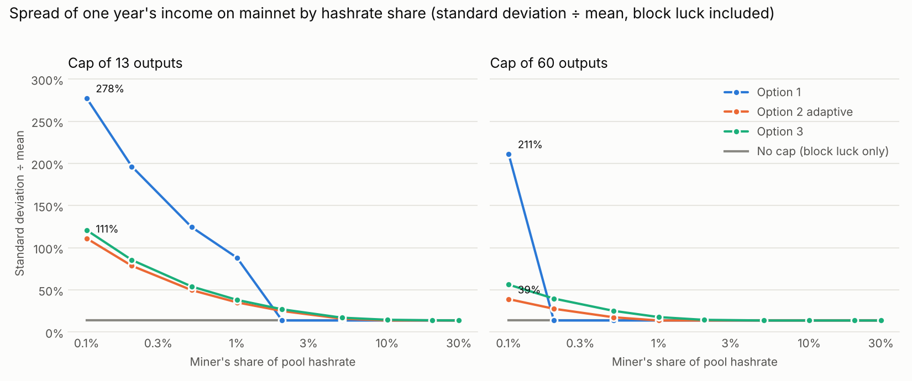
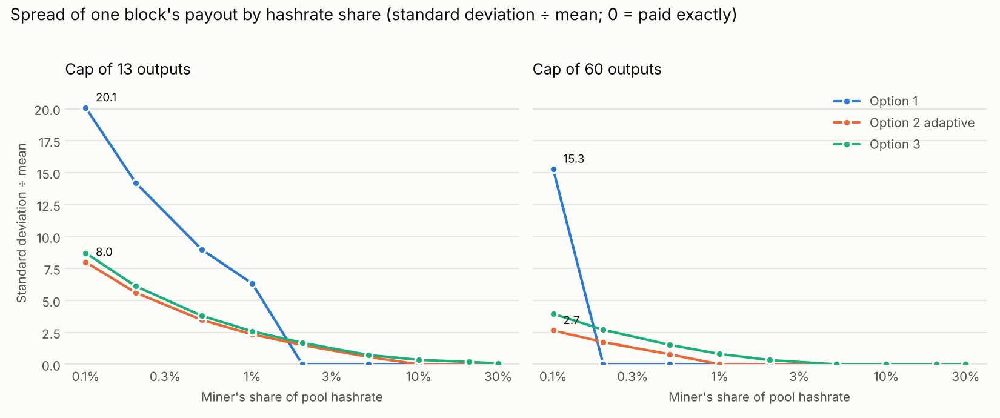

# 03 · Payout variance by hashrate share, 0.1% to 30%

**Question.** How does the variance of a miner's payout change with its share of pool hashrate, under each option?

**Sizes.** Every share is a share of **pool** hashrate, not of the Bitcoin network. The mainnet pool is 1 EH/s (0.1% of the network), so 0.1% of the pool is 1 PH/s and 30% is 300 PH/s. The two smallest rows are single machines: one S19 (95 TH/s, 0.0095% of the pool) and one S21 (200 TH/s, 0.02%).

**Method.** A miner of each size is put into the synthetic population in place of its smallest member (the other miners are scaled down to make room, and the count stays at 1,000 on mainnet). Its per-block payout distribution is computed in closed form for options 1, 2 (adaptive) and 3, at caps of 13 and 60, then checked against a 40,000-block Monte Carlo.

Three measures are reported:

- **Spread of one block's payout**: standard deviation ÷ mean. Zero means the miner is paid exactly.
- **Variance of income relative to an uncapped coinbase**: 1.0 means the raffle adds nothing to ordinary block luck; 65 means income is as variable as if the pool found 65 times fewer blocks.
- **Spread of income over a period** (a year on mainnet, a week on testnet5), block luck included.

**Run.** `python3 run.py > output.txt` (about 1 minute; needs matplotlib for the charts). Code: [run.py](run.py). Results: [output.txt](output.txt). The same tables for a 500-miner pool are in [13](../13-miner-count/README.md).

## Result: mainnet, spread of one year's income (standard deviation ÷ mean)

With no cap the figure is 13.8% for every miner; that is block luck alone at 52.6 blocks a year.

| Share of pool | Cap 13: option 1 | Cap 13: option 2 adaptive | Cap 13: option 3 | Cap 60: option 1 | Cap 60: option 2 adaptive | Cap 60: option 3 |
|---|---|---|---|---|---|---|
| One S19 (0.0095%) | 900% | 361% | 392% | 685% | 127% | 183% |
| One S21 (0.02%) | 620% | 249% | 270% | 472% | 87% | 126% |
| 0.1% | 278% | 111% | 121% | 211% | 39% | 56% |
| 0.2% | 196% | 79% | 85.5% | 13.8% | 27.7% | 39.8% |
| 0.5% | 124.5% | 50% | 54% | 13.8% | 17.6% | 25.2% |
| 1% | 88% | 35% | 38% | 13.8% | 13.8% | 17.8% |
| 2% | 13.8% | 25.0% | 27.1% | 13.8% | 13.8% | 14.5% |
| 5% | 13.8% | 15.9% | 17.1% | 13.8% | 13.8% | 13.8% |
| 10% | 13.8% | 13.8% | 14.6% | 13.8% | 13.8% | 13.8% |
| 20% | 13.8% | 13.8% | 14.0% | 13.8% | 13.8% | 13.8% |
| 30% | 13.8% | 13.8% | 13.8% | 13.8% | 13.8% | 13.8% |

Option 3 here is the evenly spaced draw; with independent draws it is worse at every size (for example 15.0% instead of 13.8% for a miner with 30% of the pool at cap 13).

The charts cover 0.1% to 30% of the pool; the two single-machine rows are in the tables only.

## Result: mainnet, variance of income relative to an uncapped coinbase

| Share of pool | Cap 13: option 1 | Cap 13: option 2 adaptive | Cap 13: option 3 | Cap 60: option 1 | Cap 60: option 2 adaptive | Cap 60: option 3 |
|---|---|---|---|---|---|---|
| One S19 (0.0095%) | 4,258 | 684 | 810 | 2,465 | 85 | 175 |
| One S21 (0.02%) | 2,023 | 325 | 385 | 1,171 | 40 | 83 |
| 0.1% | 405 | 65 | 77 | 235 | 8.1 | 16.7 |
| 0.2% | 203 | 32.5 | 38.5 | 1.0 | 4.0 | 8.3 |
| 0.5% | 81.5 | 13.0 | 15.4 | 1.0 | 1.6 | 3.3 |
| 1% | 41 | 6.5 | 7.7 | 1.0 | 1.0 | 1.7 |
| 2% | 1.0 | 3.3 | 3.8 | 1.0 | 1.0 | 1.1 |
| 5% | 1.0 | 1.3 | 1.5 | 1.0 | 1.0 | 1.0 |
| 10% | 1.0 | 1.0 | 1.1 | 1.0 | 1.0 | 1.0 |
| 20% | 1.0 | 1.0 | 1.0 | 1.0 | 1.0 | 1.0 |
| 30% | 1.0 | 1.0 | 1.0 | 1.0 | 1.0 | 1.0 |

## Result: option 2 adaptive in detail (mainnet)

| Share of pool | Cap 13: how paid | Chance per block | Payout when paid | Spread of one block's payout | Days between payouts | Cap 60: how paid | Days between payouts |
|---|---|---|---|---|---|---|---|
| One S19 (0.0095%) | raffle | 0.15% | 6.50% of block | 26.1 | 4,749 | raffle | 588 |
| One S21 (0.02%) | raffle | 0.3% | 6.50% | 18.0 | 2,256 | raffle | 279 |
| 0.1% | raffle | 1.5% | 6.50% | 8.0 | 451 | raffle | 56 |
| 0.2% | raffle | 3.1% | 6.51% | 5.6 | 226 | raffle | 28 |
| 0.5% | raffle | 7.7% | 6.52% | 3.5 | 91 | raffle | 11.3 |
| 1% | raffle | 15.3% | 6.54% | 2.35 | 45 | exactly | 6.9 |
| 2% | raffle | 30.4% | 6.58% | 1.5 | 23 | exactly | 6.9 |
| 5% | raffle | 74.8% | 6.68% | 0.58 | 9.3 | exactly | 6.9 |
| 10% to 30% | exactly | 100% | own share | 0 | 6.9 | exactly | 6.9 |

## What it shows

- Under the adaptive rule every miner above a threshold is paid exactly and has no added variance. At cap 13 that is everyone above about 6.7% of the pool (67 PH/s); at cap 60 everyone above about 0.8% (8 PH/s).
- Below that size the added variance is the prize divided by the miner's share. Halving a miner's share doubles its variance, which is why one S19 sits at 684 times no-cap variance at cap 13 and 85 times at cap 60.
- Option 1 is better than the adaptive rule for one band of miners: those large enough to be in its top 12 but below the adaptive threshold (about 1.8% to 6.7% of the pool at cap 13). They are paid exactly under option 1 and raffled under the adaptive rule, at a cost of 13.8% → 25.0% yearly spread for a miner with 2% of the pool. Everyone smaller is far better off under the adaptive rule (361% against 900% for one S19).
- Option 3 adds variance for every miner, including the largest.
- The Monte Carlo standard deviations match the closed forms within 4%.
- On testnet5 the same pattern holds over a week: 5.3% from block luck alone, and for a miner with 0.1% of the pool at cap 13, 77% under option 1, 47% under option 3 and 36% under the adaptive rule.

## Caveats

The other miners are scaled down to make room for the inserted miner, so the prize size changes slightly with it (shown in the "payout when paid" column).

Back to the [report](../../REPORT.md).
